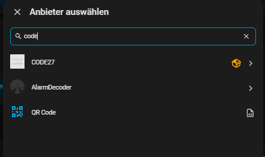
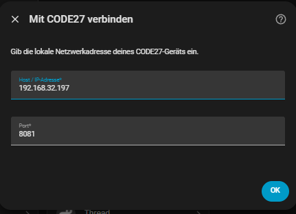
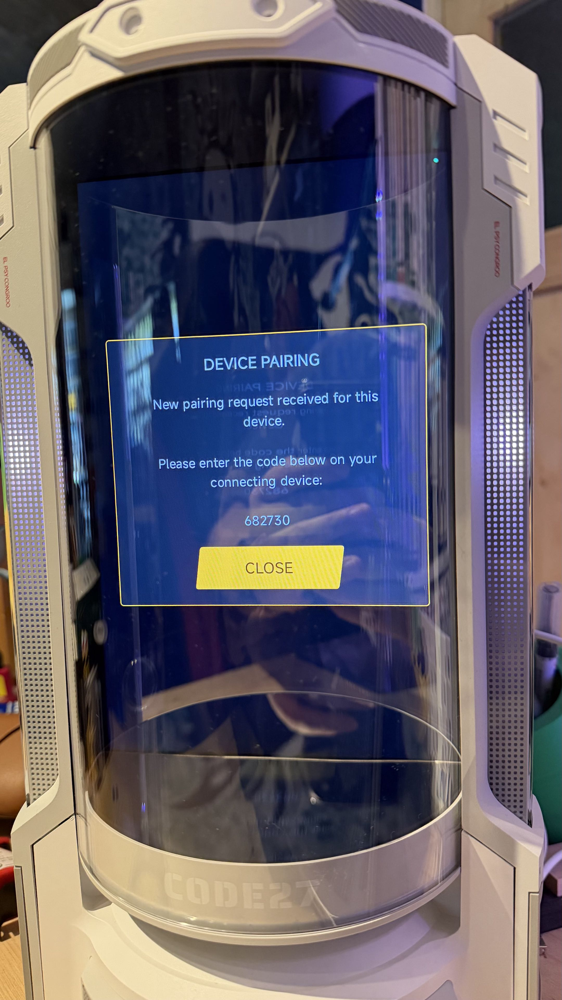
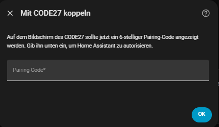
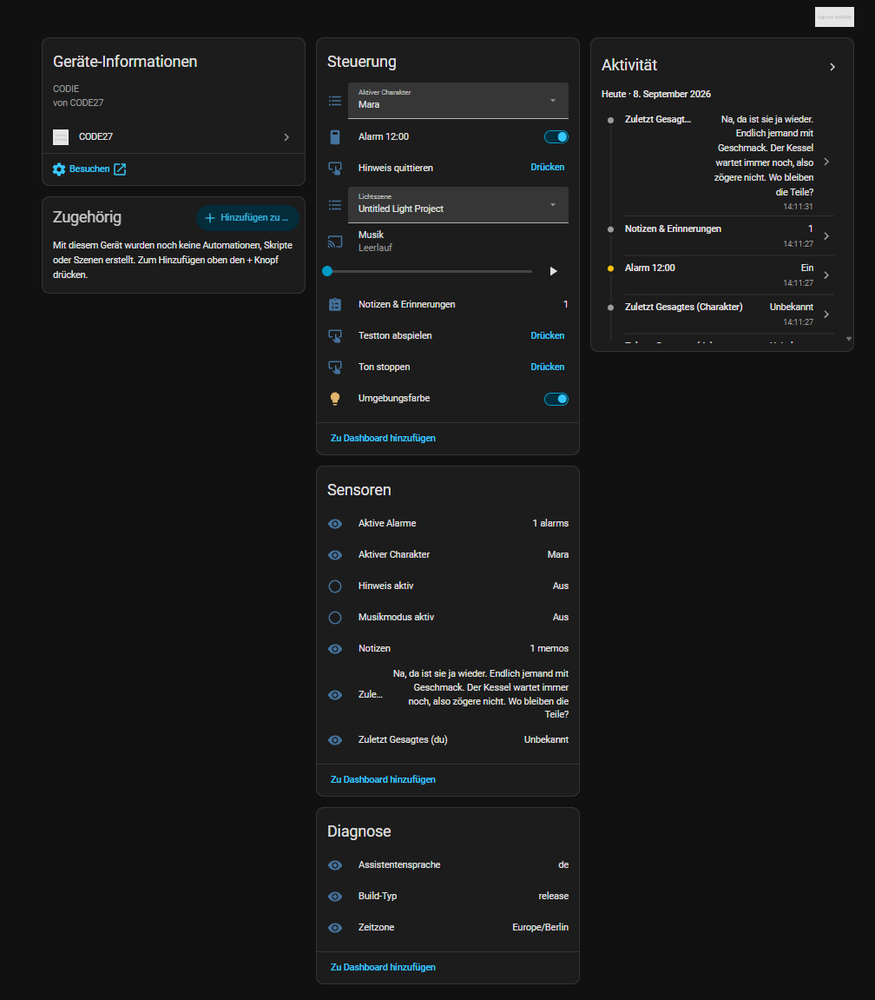
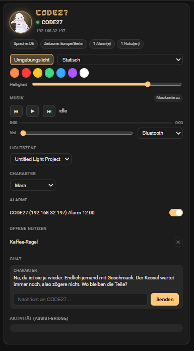

🇬🇧 English | 🇩🇪 [Deutsch](README.md)

# CODE27 (CODIE) – Home Assistant Integration

A Home Assistant `custom_component` that connects your CODE27 device (web UI at `http://<ip>:8081`, internally called **CODIE**) through its local REST and WebSocket API. The current device implementation is maintained in [HASE](https://github.com/ConstableW/ha-hase); this repository distributes it as a standalone integration under `domain=code27`.

The matching **dashboard card** (`code27-card`) provides chat, light and music controls, alarms, notes and, when HASE is also bound, an Assist Bridge activity feed.

## Contents

- [Requirements](#requirements)
- [Installation](#installation)
- [Setup (step by step)](#setup-step-by-step)
- [What gets created?](#what-gets-created)
- [Configuring options](#configuring-options)
- [Services](#services)
- [Events](#events)
- [Optional: bind CODE27 to HASE as an External Hub](#optional-bind-code27-to-hase-as-an-external-hub)
- [Dashboard card (code27-card)](#dashboard-card-code27-card)
- [Music card (HASEAMP)](#music-card-haseamp)
- [Deliberate design decisions](#deliberate-design-decisions)
- [Known limitations](#known-limitations)
- [Technical background](#technical-background)
- [Development](#development)
- [License and authorship](#license-and-authorship)
- [Support & Issues](#support--issues)

## Requirements

- A CODE27 device on the same local network as Home Assistant, reachable at
  `http://<ip>:8081`.
- Home Assistant `2025.4.0` or newer (see `hacs.json`).
- For the optional HASE Bridge: install HASE separately and configure an Assist voice assistant.

## Installation

**Via HACS (recommended):** Search for “CODE27” in HACS, download it and fully restart Home Assistant (not a reload). Until the integration is listed in the HACS catalog, use it as a custom repository.

**Fallback – custom repository:** HACS → ⋮ → *Custom repositories* → add `https://github.com/ConstableW/ha-code27` with category *Integration*, then download as above.

**Manual:** Copy the `custom_components/code27` folder into your Home Assistant `custom_components` directory and fully restart Home Assistant. For this integration type, new entities are reliably picked up only on a real restart, including after later updates.

Installing the files alone does not configure a device; the flow below creates a `code27` config entry. HASE is not required for standalone CODE27 use.

## Setup (step by step)

### 1. Add the integration

**Settings → Devices & Services → Add Integration → search "CODE27"**.



Enter the local IP address of your CODE27 device (e.g. `192.168.xxx.xxx`)
and the port (`8081`).



### 2. Pairing

A 6-digit pairing code now appears **on the CODE27 device's own screen**
(the device pairing screen, no login required – it's the same process as
connecting a new browser to the device):



Enter that code in Home Assistant:



Home Assistant gets its **own, permanent local secret** in the process –
independent of any browser session you otherwise use with the device (as if
HA had its own "device" in the CODE27 app).

### 3. Done

The integration now creates a device with all entities (see the table
below) and starts polling right away.



## What gets created?

Everything hangs off one device ("CODE27 (\<host\>)") in Home Assistant:

| Entity | Type | Description |
|---|---|---|
| Music | `media_player` | Play/pause/next/previous, volume, source (TF card/Bluetooth), title, position/duration |
| Ambient color | `light` | Free RGB color + brightness + effect (Static/Breathe/Pulse/Blink/Chase) via the Light Editor's preview channel – not persistent, never overwrites saved projects. On/off mirrors the device-wide light master switch |
| Light scene | `select` | Picks a scene saved in the Light Editor and applies it (`apply`, persistent) |
| Active character | `select` | Switches the active character slot |
| Alarm *(per alarm)* | `switch` | On/off for each alarm defined on the device, including time/repeat as attributes |
| Notes & reminders | `todo` | List with create/edit/delete, mirrored from "Lab → Notes & Reminders". **No** "done" status – the device itself only knows delete, not checking off |
| Music mode active | `binary_sensor` | Whether the music page is currently open on the device's screen |
| Notification active | `binary_sensor` | Whether a blink alert triggered via `code27.notify` is currently running (see below) |
| Acknowledge notification | `button` | Ends the current notification alert |
| Last message (you) / (character) | `sensor` | Last chat message, split by role. The character sensor additionally carries the last ~30 messages as a `history` attribute (used by the card) |
| Active character / Active alarms / Notes / Language / Timezone / Build type | `sensor` | Diagnostic and status values |
| Play test sound / Stop sound | `button` | Device test without going through the device UI |

## Configuring options

**Settings → Devices & services → CODE27 → Configure** opens the device options. The former Assist Bridge now belongs to HASE and is no longer configured here.

| Field | Meaning |
|---|---|
| Polling interval | Fallback polling for alarms, notes, character and system (15 seconds by default). Music and light status also arrive by WebSocket; chat is polled separately. |
| Remote IP recovery | Optional and off by default: after a DHCP change, tries to find the new address and verify it locally against the known device identity. |

Options are stored per CODE27 entry. The old options screenshot partly shows the pre-split Bridge; pairing screenshots remain useful orientation.

## Services

The `code27` entry owns all device actions below. Supply the device's specific `config_entry_id` in automations so multiple devices remain distinct.

| Service | Purpose |
|---|---|
| `code27.send_chat_message`, `code27.send_chat_image` | Send text or an image to the active character |
| `code27.speak` | Speak through the device's TTS preview |
| `code27.notify`, `code27.notify_clear` | Trigger or acknowledge a colored notification |
| `code27.create_alarm`, `code27.update_alarm`, `code27.delete_alarm` | Manage alarms |
| `code27.get_memory_cards`, `code27.update_memory_card` | Read or change memory cards |
| `code27.get_diary_entries`, `code27.get_diary_entry` | Read diary entries |
| `code27.upload_music`, `code27.delete_music_file` | Manage music files |
| `code27.set_music_play_mode`, `code27.set_music_sound_effect` | Set playback mode or sound effect |

Example automation action:

```yaml
action:
  - service: code27.send_chat_message
    data:
      config_entry_id: 01M20777KPCKCNGQ3F45SWX1CG
      message: "Hello!"
```

See [`custom_components/code27/services.yaml`](custom_components/code27/services.yaml) for the full field descriptions.

## Events

| Event | Payload | When |
|---|---|---|
| `code27_user_message` | `text`, `chat_id`, `slot`, `created_at`, `config_entry_id` | On every new message you write to the character |
| `code27_assistant_message` | same as above | On every new reply from the character |

These let you build your own automations, including without a HASE binding:

```yaml
alias: "CODE27: custom automation on cue"
trigger:
  - platform: event
    event_type: code27_user_message
condition:
  - condition: template
    value_template: "{{ 'good night' in trigger.event.data.text | lower }}"
action:
  - service: script.good_night_routine
```

## Optional: bind CODE27 to HASE as an External Hub

Standalone CODE27 works without HASE. To add an Assist Bridge, Spellbooks and satellites, install HASE **alongside it** and bind the already configured `code27` entry:

1. Pair CODE27 as described above. A loaded device entry must appear under **Settings → Devices & services → CODE27**.
2. Install HASE as a **separate integration** and restart Home Assistant. The packages occupy different directories: `custom_components/hase` and `custom_components/code27`.
3. Open **Settings → Devices & services → Add integration → HASE** and choose **“Bind existing standalone CODE27”**.
4. Select the intended CODE27 entry. Check its title when several devices exist. HASE creates its **own binding entry**; it does not pair the device again.
5. Open **Configure** on that HASE binding entry, enable the **Assist Bridge**, and select a Spellbook. Set a codeword, Assist agent, TTS and other HASE options as needed. Add satellites as HASE subentries on this binding.
6. Send the character a message matching a trigger in the selected Spellbook and inspect HASE's activity feed or logbook. No codeword is needed for that. If you use the codeword/Assist path instead, send a message containing the configured codeword.

The main HASE options on the binding entry:

| Option | Effect |
|---|---|
| Enable Assist Bridge | Processes matching chat messages in HASE. |
| Codewords | Comma-separated triggers such as `Computer, Homeassist`. |
| Spellbook and mode | Fixed triggers with optional codeword fallback; place your own YAML files in `<config>/hase_spellbooks/`. |
| Voice assistant | Assist agent to invoke; empty uses Home Assistant's built-in agent. |
| Relay reply to chat | Optional; the character responds to it separately. |
| Speak reply | Uses CODE27 TTS through the External Hub Contract. |
| Acknowledge phrases / AI Task | Optional notification acknowledgement or command cleanup before Assist. |

**Ownership:** The `code27` entry keeps the credentials, client, coordinator, WebSocket, device, entities and `code27.*` services. HASE uses the loaded runtime through External Hub Contract **1** and adds only its own Bridge and satellite features. HASE does not change CODE27 entry data or options. If you configure a device directly through HASE instead, it uses `domain=hase` and this standalone repository is unnecessary for that device.

If a proven matching `machine_id` already exists in either domain, the second flow aborts duplicate setup and identifies the owner. Installing the second package without configuring another entry creates no second runtime. Identity is not guaranteed across every re-pairing firmware state; there is no shared runtime lock or automatic transfer.

A missing or incompatible External Hub Contract leaves the binding unavailable with diagnostics and a repair issue. After the CODE27 entry unloads and reloads, HASE can bind its new runtime. If the standalone CODE27 entry is **deleted and recreated**, it gets a new entry ID: the old HASE binding then reports **Invalid CODE27 configuration**. Use **Reconfigure** on the HASE binding to select the new CODE27 entry, or delete the binding if it is no longer needed.

The available HASE features were tested with a physical CODE27 device on a local Home Assistant installation. This included embedded and external CODE27 binding, the Spellbooker, and MCP through hasechan. Specific technical limits and edge cases are documented in HASE.

## Dashboard card (code27-card)

A Lovelace custom card with CODE27 branding, a reactive glow in the current
ambient color, chat, and the most important controls:



### Installing the card

The card ships with the integration (`custom_components/code27/cards/code27-card.js`, served at `/code27-cards/code27-card.js`) and is loaded automatically when Home Assistant starts. You do not need to create a Lovelace resource.

1. Install the integration and **restart Home Assistant**.
2. Add the card to a dashboard, type `custom:code27-card`. A custom portrait image is optional. The card resolves the selected device's owner dynamically.

The card is **one JavaScript file**; owner resolution is included. `custom:haseamp-card` is the music card, which also ships with the integration - see [Music card (HASEAMP)](#music-card-haseamp).

### Configuration

```yaml
type: custom:code27-card
device_prefix: code27_192_168_32_197   # example; select the real value in the visual editor
name: CODE27                            # optional, defaults to "CODE27"
config_entry_id: 01M20777KPCKCNGQ3F45SWX1CG   # optional device hint; current ID comes from the registry
portrait_image: /local/code27/portrait.png    # optional, your own image
history_count: 8                        # how many chat messages are shown
show_chips: true                        # diagnostic chips (language/timezone/alarms/notes)
show_feed: true                         # useful when HASE is bound
```

The **visual card editor** is the easiest way to select the device; it fills `device_prefix`, `device_id` and `config_entry_id`. In manual YAML, `device_prefix` is a display prefix; the card resolves entities, owner domain, and current entry ID through the device registry. A saved `config_entry_id` is never blindly used for chat.

The card displays/controls: ambient light (color, effect, brightness),
music (play/pause/skip, volume, source, progress bar, music-mode badge),
light scene and character selection, alarms (list with toggles), open notes
(with a delete button), chat history with an input field, the notification
alert banner with acknowledge, diagnostic chips, and the optional HASE Assist Bridge live
feed. The card automatically follows your Home Assistant UI language
(German if set to German, English otherwise).

**Important:** After any change to `code27-card.js`, the browser remembers
the old version. Either bump the resource URL with a new `?v=` parameter,
or do a hard reload (Ctrl+Shift+R).

## Music card (HASEAMP)

`custom:haseamp-card` is the Winamp-inspired music card. It ships with this integration (`/code27-cards/haseamp-card.js`) and is loaded automatically; it talks to the WebSocket command `code27/music` (+ `code27/music/subscribe`) with the queue, stored playlists, autoadvance and the TF-card management below. Add a card of type `custom:haseamp-card`; if more than one CODE27 device exists, pick it with `target` (the `config_entry_id`). Optional keys: `name`, `show_browser`, `show_queue`, `show_playlists`, `show_import`, `show_animation`, `show_diagnostics`, `follow_light`. The queue and playlists live in Home Assistant, not in the browser. The card is optional.

### Layout, music mode and colours

* **One window, four tabs**: the player (clock, title, progress bar, transport, volume, SHF/RPT) sits on top; **Queue**, **Library**, **Playlists** and **Import** share the panel below. Double-clicking a queue row plays it; double-clicking a playlist loads it into the queue. Tab choice and selections are card state only - they never reach the backend.
* **"MusicMode is off!"**: while the device's music screen is closed (`binary_sensor` *Music mode active* / `snapshot.music_mode.active == false`) the device refuses playback commands (`MODE_INACTIVE`). The card says so in the display instead of showing a dead player, and disables the transport buttons. Queue, playlists and import stay usable. `music_mode.known` is false until the device has reported its page state - the card then shows nothing special rather than guessing.
* **Colours follow the device light**: the card reads the colour of the device's *ambient colour* light entity (read-only) and tints the whole window - title bar, bevels, buttons, tabs, text - with its hue, like a classic player skin. Lightness is pinned per part so the text stays readable, and blue/violet hues get a lighter text colour. A light that is off or unknown leaves the default green. The colour is only what Home Assistant last wrote to the light (the device has no live read-back), and it is purely cosmetic. Turn it off with `follow_light: false`.

### Music management

Everything here goes through the existing WebSocket contract; the card builds nothing the backend does not own.

| Operation | What it does |
|---|---|
| `inventory` | Every file on the TF card as `{name, size, track}`, plus files HASE uploaded that the device has not listed yet. |
| `import_chunk` | Receives one base64 piece of a file; the last piece uploads the assembled file to the card (`POST /data/user/music/upload`, audio types only, at most 64 MB per file). |
| `delete_file` / `delete_folder` | Remove one file or everything below a folder from the card (`DELETE /data/user/music/file`). The playing file is never deleted; one folder delete removes at most 500 files. Queue rows of deleted files are dropped; stored playlists keep their entries on purpose. |
| `playlist_load` + `resume: true` | Load a stored playlist and continue where it was last played: the remembered track is selected, started and moved to the remembered position (3 seconds earlier; a track that was within 5 seconds of its end continues with the next one). Without a resume point, or without `resume`, it only loads. |
| `playlist_get` / `playlist_update` | Read a stored playlist's tracks; re-order or remove rows by position (`order` = the current positions to keep, in their new order). The active queue is untouched. |
| `playlists_from_folders` | Create a stored playlist for every card folder that directly holds music (name = folder path, nested folders read `Parent / Child`; files in natural order). Folders named like a disc (`CD 1`, `Disc 02`, `Teil 3`, `Part 4`) join the playlist of the folder above, in disc order - a multi-CD audiobook becomes **one** playlist. Names are cut to the 64-character limit (the folder's own name is preferred over a truncated path). Existing playlists are skipped, deleted ones are built again, the queue is untouched. |

* **Import tab**: choose or drop audio files, an M3U **or a whole folder**, optionally name a playlist. A dropped (or chosen) folder names the playlist after itself (unless a name was typed), keeps the files in natural order and, like an M3U, uploads only what is not on the card yet. *Import only* uploads them; *Import & build playlist* uploads, replaces the queue with the imported tracks and saves it as a playlist (`queue_clear` + `queue_add` + `playlist_save_as`). The card checks the free space (`library.capacity_*`) before uploading anything.
* **M3U**: drop an `.m3u`/`.m3u8` **together with the audio files**. A browser can only read files the user hands over, so only the *file name* of each line is used (folders and drive letters are ignored). Each line is compared with the card by name and size: already on the card - added to the playlist without uploading; missing - uploaded from the chosen files; same name but different size - the version on the card is used and the row is marked `*`; neither - reported as missing; `http(s)` lines - listed but not fetched. A summary is shown first and nothing is uploaded until the user confirms. The playlist keeps the M3U's order and is named after the file.
* **Scan folders & create playlists** (Playlists tab) builds a playlist for every card folder that holds music, for card contents that did not arrive through the card (card reader, the device's own page). Existing playlists stay untouched; a deleted one is simply built again on the next scan.
* **Sound presets** (player options row): *Classical / Surround / Vocal* are the device's own presets (`SET_SOUND_EFFECT`), shown like an equalizer switch; the active one follows what the device reports (`sound_effect`). It is an equalizer replacement - the card has no access to the audio itself. The device's own play mode (`sequence`, `list_loop`, `single_loop`, `shuffle`) is deliberately **not** offered: HASE runs the queue, and a device loop mode would fight it. The device's dance setting is not part of the API (see the feedback document).
* **Resume** (Playlists tab): while a stored playlist is loaded, HASE remembers per playlist which track was playing and at which position - saved when the track changes, every 10 seconds of progress and exactly on a pause, in the runtime's store, so it survives a restart. A playlist row shows `▶ Track 5 · 12:34`; the **Resume** button (and a double click on such a row) loads the playlist and continues there. *Load* keeps loading without playing. Deleting a playlist forgets its resume point. Seeking is best effort: if the device is not ready, the track starts from its beginning.
* **Start or resume from a button or a tag**: the service `code27.play_playlist` (`config_entry_id`, `playlist`, optional `resume`, default on) loads a stored playlist and plays it - from its remembered spot, or from the first track if it was never played (or with `resume: false`). The music screen must be open on the device; otherwise the automation trace shows why it was refused, and an unknown playlist name is a clear error. A dashboard button:

  ```yaml
  type: button
  name: Audiobook
  tap_action:
    action: perform-action
    perform_action: code27.play_playlist
    data:
      config_entry_id: <the device's config entry id>
      playlist: "Walter Moers - Die 13½ Leben des Käpt'n Blaubär"
  ```

  The same call as an automation action with a tag (RFID/NFC) trigger gives a "scan the figure, continue the story" setup:

  ```yaml
  triggers:
    - trigger: tag
      tag_id: <your tag id>
  actions:
    - action: code27.play_playlist
      data:
        config_entry_id: <the device's config entry id>
        playlist: "Walter Moers - Die 13½ Leben des Käpt'n Blaubär"
  ```
* **Light scene vs. ambient colour**: the scene picker (*Lichtszene*) shows the scene the device has applied. An ambient colour written from here lies on top of it, so while it is shown the picker is **empty** until a scene is chosen again (after a restart it shows the applied scene, because the device cannot report the ambient colour back).
* **Playlist editor** (Playlists tab): selecting a playlist lists its tracks with move up/down and remove, and *Save as M3U* downloads the playlist in a form the importer reads back. A folder in the Library tab has a *Save folder as playlist* button for files that reached the card by other means.
* **TF card swap**: track uris carry the card's id (`/storage/<id>/...`). When a stored playlist is shown or loaded, tracks whose uri is not on the current card are matched by their path below `code27/music` instead; tracks without a match stay as they are and simply cannot be played.
* **Device limits worth knowing**: the device stores every upload in the **root** of its music folder - a folder name in the file name is ignored, so a dropped folder becomes a *playlist*, not a folder on the card. File names are sent unchanged (an earlier version let the HTTP client percent-encode them, which showed up as `%20` on the card; the card now displays such names decoded). The device has no file download and no playlist concept, so HASE cannot read an `.m3u` that was put on the card by other means, and the device re-indexes its file list lazily (observed: not while the music screen is closed). HASE therefore remembers its own uploads until the device lists them, and forgets them when the card changes.

## Deliberate design decisions

- **No reset/character editor**: Resetting a character or editing
  personality prompts was deliberately *not* built as an entity – those are
  consequential, device-specific actions that should stay in the device UI.
- **No personality text in HA**: The `character_prompt` (the detailed
  character description) is never shown or stored in Home Assistant – only
  the active character's name.
- **Pairing instead of stealing a cookie**: Home Assistant gets its own
  pairing when set up (like an extra "device" in the CODE27 app), instead
  of borrowing the browser session you already use.
- **No separate LED master switch anymore**: Early on there was, alongside
  the ambient-color light, its own on/off switch for the same LEDs – two
  controls for one thing is confusing, so it was removed.
- **No "restore light scene" button**: Existed briefly, was removed again –
  the behavior (revert to the "applied" project) is indistinguishable from
  the master-switch state when the saved project is empty in normal mode.
  Use the light-scene selector instead to go back to a scene, which works
  cleanly via `apply`.

## Known limitations

Everything below is deliberately *not* built because CODE27 doesn't offer
it – not because we overlooked it:

- **No device-wide volume control** outside of music playback
  (voice/sound effects) – doesn't exist anywhere in the API, not even
  behind admin rights.
- **"Spaces"** can only be selected directly on the device screen, no API
  for it.
- **No function-calling** in the character's chat (the optional HASE Assist Bridge provides a workaround; see above).
- **The card's portrait** is a generic stock image from the app bundle, not
  your actually configured character – there's no way to fetch a live
  render via the API.
- Behind admin rights (which local pairing doesn't get) sits, among other
  things, a **"Proactive" system** for automatic, presence-based greeting
  (time windows, idle recovery, camera triggers for smile/proximity/
  gesture, quiet hours) – interesting for later, should CODE27 ever open
  that up for local pairings.

## Technical background

The device requires an HMAC-SHA256 signature (`X-Local-Sig` and other
headers) for every endpoint except the three auth routes, derived from a
local secret handed out during pairing – the exact same scheme the device's
own web UI uses (reverse engineered from its JS bundle, see
`custom_components/code27/api.py`). The WebSocket channel
(`/v1/ws/channel`, see `websocket_client.py`) uses the same scheme, just as
query parameters instead of headers (a WebSocket handshake can't set
individual headers) – this is how music and light-page status arrive
essentially in real time, without any polling. There is **no** push event
for chat messages on this channel (not even the device's own web UI gets
one) – those are polled separately every 3 seconds, notably faster than the
rest (15s default interval).

The underlying device protocol was studied on real hardware in the original project. The split and the available HASE features were subsequently tested locally in Home Assistant with a physical CODE27 device.

## Development

The device implementation comes from [HASE](https://github.com/ConstableW/ha-hase) (`custom_components/hase/providers/code27/`). This repository ships it as a standalone integration with `domain=code27`. The runtime contracts (no HASE imports, package boundaries) are checked by `tests/test_code27_distribution.py`.

## License and authorship

Open source under the [Apache License 2.0](LICENSE). **Original author: ConstableW.** The [NOTICE file](NOTICE) carries the attribution. Distributors of derivative works must include the license, mark modified files, and retain applicable `NOTICE` attributions in readable form.

**AI assistance:** ChatGPT/Codex, Claude, DeepSeek, Gemini, and Ollama with the `qwen3-coder:30b` model were used as tools for analysis, design, implementation, and documentation. Parts of the project were created with AI assistance; project responsibility and decisions remain with ConstableW.

## Support & Issues

For support, feature requests, or bug reports, please visit the [CODE27 GitHub issues](https://github.com/ConstableW/ha-code27/issues). We welcome community contributions and feedback!

Buy Me a Coffee – Maintainer:

[](https://www.buymeacoffee.com/constablew)
