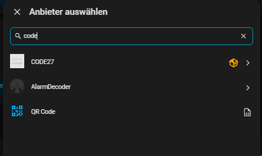
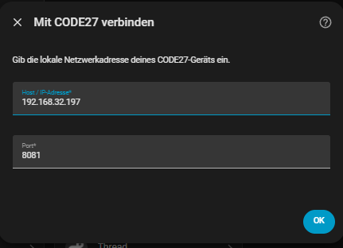
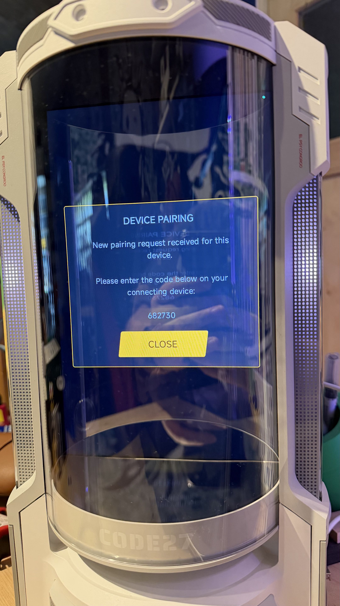
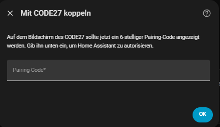
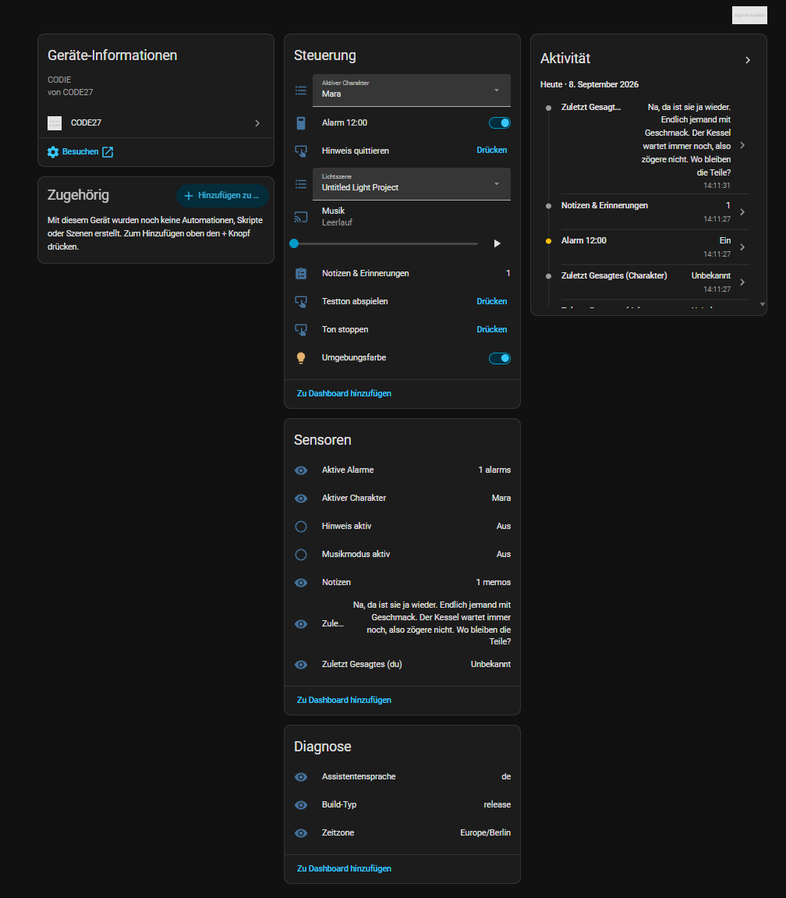
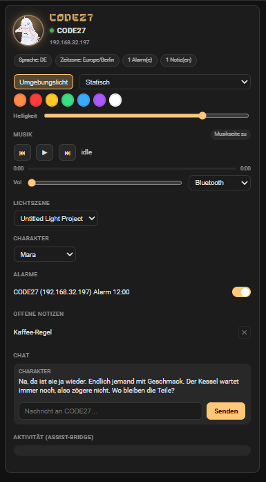

🇩🇪 Deutsch | 🇬🇧 [English](README.en.md)

# CODE27 (CODIE) – Home Assistant Integration

Eine `custom_component` für Home Assistant, die dein CODE27-Gerät (Web-UI unter `http://<ip>:8081`, intern **CODIE** genannt) über dessen lokale REST- und WebSocket-API einbindet. Die aktuelle Geräteimplementierung stammt aus [HASE](https://github.com/ConstableW/ha-hase); dieses Repository liefert sie als eigenständige Integration mit `domain=code27` aus.

Die passende **Dashboard-Karte** (`code27-card`) bietet Chat, Licht- und Musiksteuerung, Alarme, Notizen und – wenn HASE zusätzlich angebunden ist – einen Aktivitäts-Feed der Assist-Bridge.

## Inhalt

- [Voraussetzungen](#voraussetzungen)
- [Installation](#installation)
- [Einrichtung (Schritt für Schritt)](#einrichtung-schritt-für-schritt)
- [Was wird angelegt?](#was-wird-angelegt)
- [Optionen konfigurieren](#optionen-konfigurieren)
- [Services](#services)
- [Events](#events)
- [Optional: CODE27 als External Hub in HASE anbinden](#optional-code27-als-external-hub-in-hase-anbinden)
- [Dashboard-Karte (code27-card)](#dashboard-karte-code27-card)
- [Musik-Karte (HASEAMP)](#musik-karte-haseamp)
- [Bewusste Design-Entscheidungen](#bewusste-design-entscheidungen)
- [Bekannte Grenzen](#bekannte-grenzen)
- [Technischer Hintergrund](#technischer-hintergrund)
- [Entwicklung](#entwicklung)
- [Lizenz und Urheberschaft](#lizenz-und-urheberschaft)
- [Support & Issues](#support--issues)

## Voraussetzungen

- Ein CODE27-Gerät im selben lokalen Netzwerk wie Home Assistant, erreichbar
  unter `http://<ip>:8081`.
- Home Assistant ab Version `2025.4.0` (siehe `hacs.json`).
- Für die optionale HASE-Bridge: HASE zusätzlich installieren und einen Assist-Sprachassistenten einrichten.

## Installation

**Über HACS (empfohlen):** In HACS nach „CODE27“ suchen, herunterladen und Home Assistant komplett neu starten (kein Reload). Solange die Integration noch nicht im HACS-Katalog gelistet ist, geht es als benutzerdefiniertes Repository.

**Fallback – benutzerdefiniertes Repository:** HACS → ⋮ → *Benutzerdefinierte Repositories* → `https://github.com/ConstableW/ha-code27` mit Kategorie *Integration* hinzufügen, dann wie oben herunterladen.

**Manuell:** Den Ordner `custom_components/code27` in das `custom_components`-Verzeichnis der Home-Assistant-Konfiguration kopieren und Home Assistant komplett neu starten. Neue Entitäten werden bei diesem Integrationstyp zuverlässig nur bei einem echten Neustart eingelesen, auch bei späteren Updates.

Die Installation allein richtet kein Gerät ein; erst der folgende Flow legt einen `code27`-ConfigEntry an. HASE ist für den reinen CODE27-Betrieb nicht nötig.

## Einrichtung (Schritt für Schritt)

### 1. Integration hinzufügen

**Einstellungen → Geräte & Dienste → Integration hinzufügen → "CODE27"** suchen.



Gib die lokale IP-Adresse deines CODE27-Geräts (z. B. `192.168.xxx.xxx`) und
den Port (`8081`) ein.



### 2. Pairing

Auf dem **Bildschirm des CODE27-Geräts selbst** erscheint jetzt ein
6-stelliger Pairing-Code (Device-Pairing-Screen, kein Login nötig – das ist
derselbe Vorgang wie beim Verbinden eines neuen Browsers mit dem Gerät):



Diesen Code in Home Assistant eingeben:



Home Assistant erhält dabei ein **eigenes, dauerhaftes lokales Secret** –
unabhängig von jeder Browser-Session, die du sonst mit dem Gerät benutzt
(so, als hätte HA sein eigenes "Gerät" in der CODE27-App).

### 3. Fertig

Die Integration legt jetzt ein Gerät mit allen Entitäten an (siehe Tabelle
unten) und beginnt sofort mit dem Abfragen.



## Was wird angelegt?

Alles hängt an einem Gerät ("CODE27 (\<host\>)") in Home Assistant:

| Entität | Typ | Beschreibung |
|---|---|---|
| Musik | `media_player` | Play/Pause/Weiter/Zurück, Lautstärke, Quelle (TF-Karte/Bluetooth), Titel, Position/Dauer |
| Umgebungsfarbe | `light` | Freie RGB-Farbe + Helligkeit + Effekt (Statisch/Atmen/Pulsieren/Blinken/Lauflicht) über den Preview-Kanal des Light Editors – nicht persistent, überschreibt keine gespeicherten Projekte. An/Aus spiegelt den geräteweiten Licht-Master-Switch |
| Lichtszene | `select` | Wählt eine im Light Editor gespeicherte Lichtszene und wendet sie an (`apply`, dauerhaft) |
| Aktiver Charakter | `select` | Wechselt den aktiven Charakter-Slot |
| Alarm *(je Alarm)* | `switch` | Ein/Aus je auf dem Gerät angelegtem Alarm, inkl. Uhrzeit/Wiederholung als Attribute |
| Notizen & Erinnerungen | `todo` | Liste mit Anlegen/Bearbeiten/Löschen, gespiegelt aus "Lab → Notes & Reminders". **Kein** "Erledigt"-Status – das Gerät kennt selbst nur Löschen, kein Abhaken |
| Musikmodus aktiv | `binary_sensor` | Ob die Musik-Seite gerade auf dem Gerätebildschirm offen ist |
| Hinweis aktiv | `binary_sensor` | Ob gerade ein per `code27.notify` ausgelöster Blink-Alarm läuft (siehe unten) |
| Hinweis quittieren | `button` | Beendet den aktuellen Hinweis-Alarm |
| Zuletzt Gesagtes (du) / (Charakter) | `sensor` | Letzte Chat-Nachricht, getrennt nach Rolle. Der Charakter-Sensor trägt zusätzlich die letzten ~30 Nachrichten als `history`-Attribut (Basis für die Karte) |
| Aktiver Charakter / Aktive Alarme / Notizen / Sprache / Zeitzone / Build-Typ | `sensor` | Diagnose- und Statuswerte |
| Testton abspielen / Ton stoppen | `button` | Gerätetest ohne Umweg über die Geräte-UI |

## Optionen konfigurieren

**Einstellungen → Geräte & Dienste → CODE27 → Konfigurieren** öffnet die Geräte-Optionen. Die frühere Assist-Bridge gehört jetzt zu HASE und erscheint hier nicht mehr.

| Feld | Bedeutung |
|---|---|
| Abfrageintervall | Sicherheitsnetz-Polling für Alarme, Notizen, Charakter und System (Standard 15 Sekunden). Musik- und Licht-Status kommen zusätzlich über WebSocket, Chat wird separat abgefragt. |
| Remote-IP-Recovery | Optional und standardmäßig aus: versucht nach einem DHCP-Wechsel die neue Geräteadresse zu finden und lokal gegen die bekannte Geräteidentität zu prüfen. |

Die Optionen gelten pro CODE27-Entry. Die alten Screenshots des Options-Dialogs zeigen zum Teil noch die vor dem Split enthaltene Bridge; die Pairing-Screenshots bleiben als Orientierung erhalten.

## Services

Alle folgenden Geräteaktionen gehören dem `code27`-Entry. In Automationen den konkreten `config_entry_id` des Geräts angeben; bei mehreren Geräten ist damit das Ziel eindeutig.

| Service | Beschreibung |
|---|---|
| `code27.send_chat_message`, `code27.send_chat_image` | Text oder Bild an den aktiven Charakter schicken |
| `code27.speak` | Text über die TTS-Vorschau des Geräts ausgeben |
| `code27.notify`, `code27.notify_clear` | Farbigen Hinweis auslösen bzw. quittieren |
| `code27.create_alarm`, `code27.update_alarm`, `code27.delete_alarm` | Alarme verwalten |
| `code27.get_memory_cards`, `code27.update_memory_card` | Memory Cards lesen bzw. ändern |
| `code27.get_diary_entries`, `code27.get_diary_entry` | Tagebuch lesen |
| `code27.upload_music`, `code27.delete_music_file` | Musikdateien verwalten |
| `code27.set_music_play_mode`, `code27.set_music_sound_effect` | Wiedergabemodus bzw. Sound-Effekt setzen |

Beispiel für eine Automation:

```yaml
action:
  - service: code27.send_chat_message
    data:
      config_entry_id: 01M20777KPCKCNGQ3F45SWX1CG
      message: "Hallo!"
```

Die vollständigen Feldbeschreibungen stehen in [`custom_components/code27/services.yaml`](custom_components/code27/services.yaml).

## Events

| Event | Payload | Wann |
|---|---|---|
| `code27_user_message` | `text`, `chat_id`, `slot`, `created_at`, `config_entry_id` | Bei jeder neuen Nachricht, die du dem Charakter schreibst |
| `code27_assistant_message` | wie oben | Bei jeder neuen Antwort des Charakters |

Damit lassen sich eigene Automationen bauen, auch ohne HASE-Binding:

```yaml
alias: "CODE27: eigene Automation auf Zuruf"
trigger:
  - platform: event
    event_type: code27_user_message
condition:
  - condition: template
    value_template: "{{ 'gute nacht' in trigger.event.data.text | lower }}"
action:
  - service: script.gute_nacht_routine
```

## Optional: CODE27 als External Hub in HASE anbinden

CODE27 standalone funktioniert ohne HASE. Für Assist-Bridge, Spellbooks und Satelliten kannst du HASE **zusätzlich** installieren und den bereits eingerichteten `code27`-Entry anbinden:

1. Zuerst CODE27 wie oben pairen. Unter **Einstellungen → Geräte & Dienste → CODE27** muss ein geladener Geräte-Entry sichtbar sein.
2. HASE als **separate Integration** installieren und Home Assistant neu starten. HASE und CODE27 belegen unterschiedliche Verzeichnisse: `custom_components/hase` und `custom_components/code27`.
3. **Einstellungen → Geräte & Dienste → Integration hinzufügen → HASE** öffnen und **„Vorhandenen eigenständigen CODE27 anbinden“** wählen.
4. Den gewünschten CODE27-Entry aus der Liste auswählen. Gerade bei mehreren Geräten den Titel prüfen. HASE legt dafür einen **eigenen Binding-Entry** an; es wird kein zweites Geräte-Pairing verlangt.
5. Auf dem HASE-Binding-Entry **Konfigurieren** öffnen, **Assist-Bridge aktivieren** und ein Spellbook auswählen. Codewort, Assist-Agent, TTS oder andere HASE-Funktionen nach Bedarf einstellen. Satelliten als HASE-Subentries an diesem Binding hinzufügen.
6. Einen zum ausgewählten Spellbook passenden Trigger an den Charakter senden und den HASE-Aktivitäts-Feed bzw. das Logbuch prüfen. Dafür ist kein Codewort erforderlich. Wenn du stattdessen den Codewort-/Assist-Weg nutzt, sende eine Nachricht mit dem konfigurierten Codewort.

Die wichtigsten HASE-Optionen auf dem Binding-Entry:

| Option | Wirkung |
|---|---|
| Assist-Bridge aktivieren | Verarbeitet passende Chat-Nachrichten in HASE. |
| Codewort(e) | Kommagetrennte Auslöser wie `Computer, Homeassist`. |
| Spellbook und Modus | Feste Trigger und optionaler Fallback auf das Codewort; eigene YAML-Dateien gehören in `<config>/hase_spellbooks/`. |
| Sprachassistent | Assist-Agent für die Ausführung; leer verwendet den eingebauten Home-Assistant-Agenten. |
| Antwort zurück in den Chat | Optional; der Charakter reagiert darauf selbst noch einmal. |
| Antwort laut aussprechen | Nutzt CODE27-TTS über den External-Hub-Contract. |
| Quittier-Phrasen / AI Task | Optionaler Hinweis-Acknowledge bzw. Befehlsbereinigung vor Assist. |

**Ownership:** Der `code27`-Entry behält Credentials, Client, Coordinator, WebSocket, Device, Entities und `code27.*`-Dienste. HASE nutzt die geladene Runtime über External-Hub-Contract **1** und ergänzt nur eigene Bridge-/Satellite-Funktionen. HASE ändert keine Daten oder Optionen des CODE27-Entry. Für ein Gerät, das du stattdessen direkt über HASE einrichtest, gilt `domain=hase`; dafür brauchst du dieses Standalone-Repository nicht.

Wenn ein belegbar identischer `machine_id` bereits in einer Domain eingerichtet ist, beendet der zweite Flow die doppelte Einrichtung mit Hinweis auf den Owner. Eine Installation ohne erneuten Einrichtungs-Flow erzeugt keine zweite Runtime. Die Identität ist bei erneutem Pairing nicht für jeden Firmware-Zustand garantiert; es gibt keinen gemeinsamen Runtime-Lock und keine automatische Übernahme.

Ist der External-Hub-Contract nicht vorhanden oder nicht kompatibel, bleibt das Binding unavailable und zeigt eine Diagnose/Repair-Meldung. Nach Unload/Reload des CODE27-Entry kann HASE die neue Runtime erneut binden. Wird der standalone CODE27-Entry **gelöscht und neu eingerichtet**, erhält er eine neue Entry-ID: Das alte HASE-Binding zeigt dann **Ungültige CODE27-Konfiguration**. Unter **HASE → Neu konfigurieren** den neuen CODE27-Entry auswählen oder das nicht mehr benötigte Binding löschen.

Im lokalen Home-Assistant-Realtest wurden die verfügbaren HASE-Funktionen mit einem physischen CODE27 getestet. Dazu gehörten die eingebettete und die externe CODE27-Anbindung, der Spellbooker und MCP über hasechan. Spezifische technische Grenzen und Randfälle sind in der HASE-Dokumentation beschrieben.

## Dashboard-Karte (code27-card)

Eine Lovelace-Custom-Card mit CODE27-Branding, reaktivem Glow in der
aktuellen Umgebungsfarbe, Chat und den wichtigsten Bedienelementen:



### Installation der Karte

Die Karte wird von der Integration mitgeliefert (`custom_components/code27/cards/code27-card.js`, erreichbar unter `/code27-cards/code27-card.js`) und beim Start von Home Assistant automatisch geladen. Eine Lovelace-Ressource musst du nicht anlegen.

1. Integration installieren und **Home Assistant neu starten**.
2. Karte auf einem Dashboard hinzufügen, Typ `custom:code27-card`. Ein eigenes Portrait-Bild ist optional. Die Karte wählt den Owner des ausgewählten Geräts dynamisch.

Die Karte besteht aus **einer einzigen JavaScript-Datei**; die Owner-Auflösung ist darin enthalten. `custom:haseamp-card` ist die Musik-Karte, die ebenfalls mitgeliefert wird - siehe [Musik-Karte (HASEAMP)](#musik-karte-haseamp).

### Konfiguration

```yaml
type: custom:code27-card
device_prefix: code27_192_168_32_197   # Beispiel; tatsächlichen Wert im visuellen Editor wählen
name: CODE27                            # optional, Standard "CODE27"
config_entry_id: 01M20777KPCKCNGQ3F45SWX1CG   # optionaler Gerätehinweis; aktuelle ID wird aus der Registry gelesen
portrait_image: /local/code27/portrait.png    # optional, eigenes Bild
history_count: 8                        # wie viele Chat-Nachrichten angezeigt werden
show_chips: true                        # Diagnose-Chips (Sprache/Zeitzone/Alarme/Notizen)
show_feed: true                         # Feed nur mit HASE-Binding sinnvoll
```

Am einfachsten wählst du das Gerät im **visuellen Karten-Editor**; er trägt `device_prefix`, `device_id` und `config_entry_id` ein. Bei manuellem YAML ist `device_prefix` ein Anzeigepräfix; die Karte löst Entities, Owner-Domain und aktuelle Entry-ID über die Device-Registry auf. Eine gespeicherte `config_entry_id` wird nicht blind für Chat verwendet.

Die Karte zeigt/steuert: Umgebungslicht (Farbe, Effekt, Helligkeit),
Musik (Play/Pause/Skip, Lautstärke, Quelle, Fortschrittsbalken,
Musikmodus-Badge), Lichtszene- und Charakter-Auswahl, Alarme (Liste mit
Umschaltern), offene Notizen (mit Löschen-Button), Chat-Verlauf mit
Eingabefeld, den Hinweis-Alarm-Banner samt Quittieren, Diagnose-Chips und
optional den Live-Feed der HASE-Assist-Bridge. Die Karte folgt dabei automatisch deiner
Home-Assistant-Oberflächensprache (Deutsch bei Deutsch, sonst Englisch).

**Wichtig:** Nach jeder Änderung an `code27-card.js` merkt sich der Browser
die alte Version. Entweder die Ressourcen-URL mit einem neuen
`?v=`-Parameter versehen, oder Strg+Shift+R (harter Reload).

## Musik-Karte (HASEAMP)

`custom:haseamp-card` ist die Winamp-inspirierte Musik-Karte. Sie wird zusammen mit dieser Integration ausgeliefert (`/code27-cards/haseamp-card.js`) und automatisch geladen; sie spricht mit dem WebSocket-Befehl `code27/music` (+ `code27/music/subscribe`) mit Queue, gespeicherten Playlists, Autoadvance und der unten beschriebenen TF-Karten-Verwaltung. Lege eine Card vom Typ `custom:haseamp-card` an; bei mehreren CODE27-Geräten das Gerät per `target` (die `config_entry_id`) wählen. Optionale Schlüssel: `name`, `show_browser`, `show_queue`, `show_playlists`, `show_import`, `show_animation`, `show_diagnostics`, `follow_light`. Queue und Playlists liegen in Home Assistant, nicht im Browser. Die Karte ist optional.

### Aufbau, MusicMode und Farben

* **Ein Fenster, vier Tabs**: Oben sitzt der Player (Uhr, Titel, Fortschrittsbalken, Transport, Lautstärke, SHF/RPT); **Queue**, **Bibliothek**, **Playlists** und **Import** teilen sich das Feld darunter. Doppelklick auf eine Queue-Zeile spielt sie, Doppelklick auf eine Playlist lädt sie in die Queue. Tab-Wahl und Markierungen sind reiner Card-Zustand und erreichen nie das Backend.
* **„MusicMode ist off!“**: Solange die Musik-Ansicht am Gerät geschlossen ist (`binary_sensor` *Musikmodus aktiv* / `snapshot.music_mode.active == false`), lehnt das Gerät Wiedergabe-Befehle ab (`MODE_INACTIVE`). Die Card schreibt das ins Display, statt einen toten Player zu zeigen, und sperrt die Transport-Tasten. Queue, Playlists und Import bleiben nutzbar. `music_mode.known` ist false, bis das Gerät seinen Seitenzustand gemeldet hat - dann zeigt die Card nichts Besonderes, statt zu raten.
* **Farben folgen dem Gerätelicht**: Die Card liest die Farbe der Licht-Entität *Umgebungsfarbe* des Geräts (nur lesend) und färbt das ganze Fenster - Titelleiste, Rahmen, Buttons, Tabs, Schrift - in deren Farbton, wie ein klassischer Player-Skin. Die Helligkeit ist je Teil festgelegt, damit der Text lesbar bleibt; Blau- und Violetttöne bekommen eine hellere Schrift. Ein ausgeschaltetes oder unbekanntes Licht lässt das Standard-Grün. Die Farbe ist nur das, was Home Assistant zuletzt ins Licht geschrieben hat (das Gerät hat keinen Live-Readback), und rein kosmetisch. Abschalten mit `follow_light: false`.

### Musikverwaltung

Alles läuft über den bestehenden WebSocket-Vertrag; die Card baut nichts, was das Backend nicht selbst besitzt.

| Operation | Wirkung |
|---|---|
| `inventory` | Alle Dateien auf der TF-Karte als `{name, size, track}`, dazu Dateien, die HASE hochgeladen hat und das Gerät noch nicht listet. |
| `import_chunk` | Nimmt ein base64-Stück einer Datei entgegen; das letzte Stück lädt die zusammengesetzte Datei auf die Karte (`POST /data/user/music/upload`, nur Audio-Typen, höchstens 64 MB je Datei). |
| `delete_file` / `delete_folder` | Entfernen eine Datei bzw. alles unter einem Ordner von der Karte (`DELETE /data/user/music/file`). Die laufende Datei wird nie gelöscht; ein Ordner-Löschen entfernt höchstens 500 Dateien. Queue-Zeilen gelöschter Dateien entfallen; gespeicherte Playlists behalten ihre Einträge absichtlich. |
| `playlist_load` + `resume: true` | Lädt eine gespeicherte Playlist und macht dort weiter, wo zuletzt gespielt wurde: der gemerkte Titel wird gewählt, gestartet und an die gemerkte Stelle gesetzt (3 Sekunden früher; ein Titel, der höchstens 5 Sekunden vor dem Ende war, geht mit dem nächsten weiter). Ohne Fortsetzungspunkt oder ohne `resume` wird nur geladen. |
| `playlist_get` / `playlist_update` | Titel einer gespeicherten Playlist lesen; Zeilen per Position umsortieren oder entfernen (`order` = die aktuellen Positionen, die bleiben, in neuer Reihenfolge). Die aktive Queue bleibt unberührt. |
| `playlists_from_folders` | Legt für jeden Kartenordner, der direkt Musik enthält, eine gespeicherte Playlist an (Name = Ordnerpfad, verschachtelt `Eltern / Kind`; Dateien in natürlicher Reihenfolge). Ordner, die wie eine CD heißen (`CD 1`, `Disc 02`, `Teil 3`, `Part 4`), gehören zur Playlist des Ordners darüber, in CD-Reihenfolge - ein Hörbuch mit mehreren CDs wird **eine** Playlist. Namen werden auf die Grenze von 64 Zeichen gekürzt (der eigene Ordnername geht vor einem gekürzten Pfad). Bestehende Playlists werden übersprungen, gelöschte neu gebaut, die Queue bleibt unberührt. |

* **Import-Tab**: Audiodateien, eine M3U **oder einen ganzen Ordner** wählen oder hineinziehen, optional eine Playlist benennen. Ein hineingezogener (oder gewählter) Ordner benennt die Playlist nach sich (außer es wurde ein Name getippt), behält die Dateien in natürlicher Reihenfolge und lädt wie die M3U nur hoch, was noch nicht auf der Karte liegt. *Nur importieren* lädt sie hoch; *Importieren & Playlist bauen* lädt hoch, ersetzt die Queue durch die importierten Titel und speichert sie als Playlist (`queue_clear` + `queue_add` + `playlist_save_as`). Vor dem Hochladen prüft die Card den freien Platz (`library.capacity_*`).
* **M3U**: Eine `.m3u`/`.m3u8` **zusammen mit den Audiodateien** hineinziehen. Ein Browser kann nur Dateien lesen, die der Nutzer ihm gibt - verwendet wird daher nur der *Dateiname* jeder Zeile (Ordner und Laufwerksbuchstaben spielen keine Rolle). Jede Zeile wird mit der Karte nach Name und Größe verglichen: schon auf der Karte - kommt ohne Upload in die Playlist; fehlt - wird aus den gewählten Dateien hochgeladen; gleicher Name, andere Größe - die Version auf der Karte gilt, die Zeile trägt ein `*`; weder noch - wird als fehlend gemeldet; `http(s)`-Zeilen - werden aufgelistet, aber nicht geladen. Erst erscheint eine Zusammenfassung, hochgeladen wird erst nach Bestätigung. Die Playlist behält die Reihenfolge der M3U und heißt wie die Datei.
* **Ordner scannen & Playlists anlegen** (Tab Playlists) baut für jeden Kartenordner mit Musik eine Playlist - gedacht für Karteninhalt, der nicht über die Card kam (Kartenleser, die Geräteseite). Bestehende Playlists bleiben unberührt; eine gelöschte entsteht beim nächsten Scan neu.
* **Klangvoreinstellungen** (Optionszeile des Players): *Klassik / Surround / Stimme* sind die eigenen Voreinstellungen des Geräts (`SET_SOUND_EFFECT`), dargestellt wie ein Equalizer-Schalter; die aktive folgt dem, was das Gerät meldet (`sound_effect`). Sie ersetzen einen Equalizer - die Card hat keinen Zugriff auf das Audio selbst. Den Abspielmodus des Geräts (`sequence`, `list_loop`, `single_loop`, `shuffle`) bieten wir bewusst **nicht** an: HASE führt die Queue, ein Loop-Modus am Gerät würde dagegen arbeiten. Die Tanz-Einstellung des Geräts ist nicht Teil der API (siehe Feedback-Dokument).
* **Fortsetzen** (Tab Playlists): Solange eine gespeicherte Playlist geladen ist, merkt sich HASE je Playlist, welcher Titel an welcher Stelle lief - gespeichert beim Titelwechsel, alle 10 Sekunden Fortschritt und exakt bei einer Pause, im Store der Runtime, also auch über einen Neustart. Eine Playlist-Zeile zeigt `▶ Titel 5 · 12:34`; der Button **Fortsetzen** (und ein Doppelklick auf so eine Zeile) lädt die Playlist und macht dort weiter. *Laden* lädt weiterhin ohne abzuspielen. Beim Löschen einer Playlist wird ihr Fortsetzungspunkt vergessen. Das Spulen ist best effort: Ist das Gerät nicht bereit, beginnt der Titel von vorn.
* **Per Button oder Tag starten bzw. fortsetzen**: Der Service `code27.play_playlist` (`config_entry_id`, `playlist`, optional `resume`, Standard an) lädt eine gespeicherte Playlist und spielt sie ab - an der gemerkten Stelle oder, wenn sie noch nie gespielt wurde (oder mit `resume: false`), ab dem ersten Titel. Die Musik-Ansicht muss am Gerät offen sein; sonst zeigt die Automations-Ablaufverfolgung, warum abgelehnt wurde, und ein unbekannter Playlist-Name ist ein klarer Fehler. Ein Dashboard-Button:

  ```yaml
  type: button
  name: Hörbuch
  tap_action:
    action: perform-action
    perform_action: code27.play_playlist
    data:
      config_entry_id: <Config-Entry-ID des Geräts>
      playlist: "Walter Moers - Die 13½ Leben des Käpt'n Blaubär"
  ```

  Derselbe Aufruf als Automations-Aktion mit einem Tag-Trigger (RFID/NFC) ergibt „Figur scannen, Geschichte weiterhören“:

  ```yaml
  triggers:
    - trigger: tag
      tag_id: <deine Tag-ID>
  actions:
    - action: code27.play_playlist
      data:
        config_entry_id: <Config-Entry-ID des Geräts>
        playlist: "Walter Moers - Die 13½ Leben des Käpt'n Blaubär"
  ```
* **Lichtszene und Umgebungsfarbe**: Die Szenen-Auswahl (*Lichtszene*) zeigt die Szene, die das Gerät angewendet hat. Eine von hier geschriebene Umgebungsfarbe liegt darüber, deshalb ist die Auswahl **leer**, solange sie gezeigt wird, bis wieder eine Szene gewählt wird (nach einem Neustart zeigt sie die angewendete Szene, weil das Gerät die Umgebungsfarbe nicht zurückmelden kann).
* **Playlist-Editor** (Tab Playlists): Eine gewählte Playlist zeigt ihre Titel mit Nach oben/unten und Entfernen; *Als M3U speichern* lädt die Playlist in einer Form herunter, die der Import wieder lesen kann. Ein Ordner im Tab Bibliothek hat einen Button *Ordner als Playlist speichern* für Dateien, die auf anderem Weg auf die Karte kamen.
* **TF-Karte wechseln**: Track-URIs tragen die Karten-ID (`/storage/<id>/...`). Wird eine gespeicherte Playlist angezeigt oder geladen, werden Titel, deren URI nicht auf der aktuellen Karte liegt, stattdessen über ihren Pfad unterhalb von `code27/music` zugeordnet; Titel ohne Treffer bleiben unverändert und sind einfach nicht abspielbar.
* **Gerätegrenzen**: Das Gerät legt jeden Upload im **Root** seines Musikordners ab - ein Ordnername im Dateinamen wird ignoriert, ein hineingezogener Ordner wird also zur *Playlist*, nicht zu einem Ordner auf der Karte. Dateinamen gehen unverändert hinaus (eine frühere Version ließ den HTTP-Client sie prozentkodieren, was auf der Karte als `%20` auftauchte; die Card zeigt solche Namen jetzt dekodiert). Das Gerät kennt weder Datei-Download noch Playlists, daher kann HASE keine `.m3u` lesen, die anderweitig auf die Karte kam, und das Gerät führt seine Dateiliste träge nach (beobachtet: nicht bei geschlossener Musik-Ansicht). HASE merkt sich deshalb eigene Uploads, bis das Gerät sie listet, und vergisst sie beim Kartenwechsel.

## Bewusste Design-Entscheidungen

- **Kein Reset/Character-Editor**: Das Zurücksetzen eines Charakters oder das
  Bearbeiten von Persönlichkeits-Prompts wurde bewusst *nicht* als Entität
  angelegt – das sind folgenreiche, gerätespezifische Aktionen, die weiterhin
  über die Geräte-UI laufen sollten.
- **Kein Persönlichkeits-Text in HA**: Der `character_prompt` (die
  ausführliche Charakterbeschreibung) wird nirgends in Home Assistant
  angezeigt oder gespeichert – nur der Name des aktiven Charakters.
- **Pairing statt Cookie-Klau**: Home Assistant bekommt beim Einrichten ein
  eigenes Pairing (wie ein zusätzliches "Gerät" in der CODE27-App), anstatt
  sich die Browser-Session zu leihen.
- **Kein separater LED-Master-Schalter mehr**: Anfangs gab es zusätzlich zum
  Umgebungsfarbe-Licht einen eigenen An/Aus-Schalter für dieselben LEDs –
  zwei Bedienelemente für ein Ding ist verwirrend, wurde entfernt.
- **Kein "Lichtszene wiederherstellen"-Button**: Existierte kurzzeitig, wurde
  wieder entfernt – das Verhalten (zurück zum "applied" Projekt) ist nicht
  vom Master-Switch-Status unterscheidbar, wenn das gespeicherte Projekt im
  Normal-Modus leer ist. Für "zu einer Szene zurück" die Lichtszene-Auswahl
  benutzen, die per `apply` sauber funktioniert.

## Bekannte Grenzen

Alles unten ist bewusst *nicht* gebaut, weil CODE27 es nicht anbietet – nicht
weil wir es übersehen hätten:

- **Kein geräteweites Lautstärke-Feature** außerhalb der Musikwiedergabe
  (Stimme/Sound-Effekte) – existiert nirgends in der API, auch nicht hinter
  Admin-Rechten.
- **"Spaces"** sind nur direkt am Gerätebildschirm wählbar, keine API dafür.
- **Kein Function-Calling** im Chat des Charakters (deshalb die
  HASE-Assist-Bridge als optionaler Workaround, siehe oben).
- **Portrait in der Karte** ist ein generisches Stock-Bild aus dem
  App-Bundle, nicht dein tatsächlich konfigurierter Charakter – dafür gibt's
  keine abrufbare Live-Renderansicht über die API.
- Hinter Admin-Rechten (die das lokale Pairing nicht bekommt) steckt u. a.
  ein **"Proactive"-System** für automatisches, präsenzbasiertes Ansprechen
  (Zeitfenster, Idle-Recovery, Kamera-Trigger für Lächeln/Näherung/Geste,
  Ruhezeiten) – spannend für später, falls CODE27 das mal für lokale
  Pairings öffnet.

## Technischer Hintergrund

Das Gerät verlangt für alle Endpunkte außer den drei Auth-Routen eine
HMAC-SHA256-Signatur (`X-Local-Sig` u. a. Header), abgeleitet aus einem beim
Pairing vergebenen lokalen Secret – dasselbe Verfahren, das die Web-UI des
Geräts selbst verwendet (aus deren JS-Bundle nachvollzogen, siehe
`custom_components/code27/api.py`). Der WebSocket-Kanal
(`/v1/ws/channel`, siehe `websocket_client.py`) nutzt dasselbe Verfahren,
nur als Query-Parameter statt Header (ein WebSocket-Handshake kann keine
individuellen Header setzen) – darüber kommen Musik- und Licht-Seiten-Status
praktisch in Echtzeit rein, ganz ohne Polling. Für Chat-Nachrichten gibt es
auf diesem Kanal **kein** Push-Event (nicht mal die eigene Web-UI des Geräts
bekommt da eins) – die werden separat alle 3 Sekunden abgefragt, deutlich
schneller als der Rest (15s Standard-Intervall).

Das zugrunde liegende Geräteprotokoll wurde im Ausgangsprojekt an echter Hardware untersucht. Der Split und die verfügbaren HASE-Funktionen wurden anschließend lokal in Home Assistant mit einem physischen CODE27 getestet.

## Entwicklung

Die Geräteimplementierung stammt aus [HASE](https://github.com/ConstableW/ha-hase) (`custom_components/hase/providers/code27/`). Dieses Repository liefert sie als eigenständige Integration mit `domain=code27` aus. Die Laufzeit-Verträge (keine HASE-Importe, Paketgrenzen) prüft `tests/test_code27_distribution.py`.

## Lizenz und Urheberschaft

Open Source unter der [Apache-Lizenz 2.0](LICENSE). **Originalautor: ConstableW.** Die [NOTICE-Datei](NOTICE) enthält den Urheberhinweis. Wer eine abgeleitete Fassung weitergibt, muss die Lizenz beilegen, Änderungen kennzeichnen und die zutreffenden Hinweise aus `NOTICE` in lesbarer Form erhalten.

**KI-Unterstützung:** Bei Analyse, Entwurf, Implementierung und Dokumentation wurden ChatGPT/Codex, Claude, DeepSeek, Gemini sowie Ollama mit dem Modell `qwen3-coder:30b` als Werkzeuge eingesetzt. Teile des Projekts entstanden mit KI-Unterstützung; Projektverantwortung und Entscheidungen liegen bei ConstableW.

## Support & Issues

Für Support, Feature-Wünsche und Fehlermeldungen nutze bitte die [GitHub-Issues von CODE27](https://github.com/ConstableW/ha-code27/issues). Beiträge und Feedback aus der Community sind willkommen!

Buy Me a Coffee – Maintainer:

[](https://www.buymeacoffee.com/constablew)
